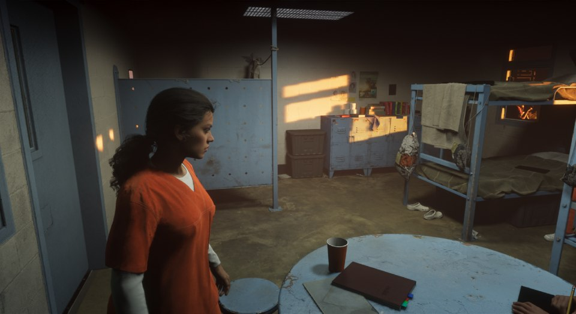
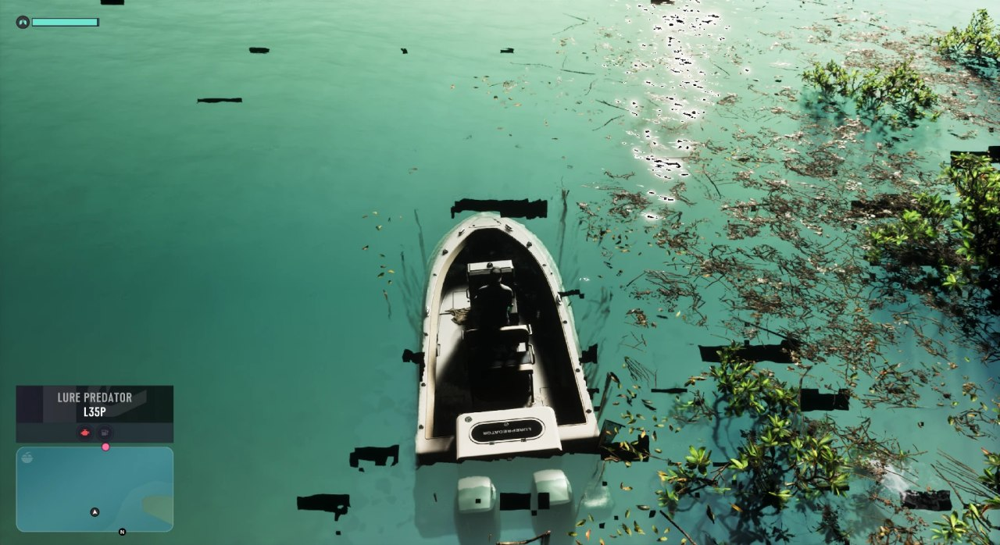

# victory-dedsec: GTA VI (Xbox Series build) on a Windows PC with an NVIDIA RTX card

Fixes, settings and measurements from running **Grand Theft Auto VI** (GTA 6), the Xbox Series
X|S build v1.0.2.1, on a Windows PC through **VIctory**: an open-source compatibility layer
written in Rust. It loads the title's own executable, stands in for the console's runtime
services, puts the console's Direct3D 12.X on top of the PC's Direct3D 12 and translates the
console's shaders to DXIL, with DLSS and frame generation on NVIDIA RTX cards. It is not an
emulator: the game's code runs on the PC's own processor.

> **No game files here, and nothing about where to get any.** You need your own legally obtained
> copy of the game. This project is not affiliated with or endorsed by the game's developer or
> publisher, nor by NVIDIA or AMD. The tree holds no game files, code or assets, by the rule in
> [docs/asset-policy.md](docs/asset-policy.md); the screenshots further down are from this
> repository's earlier history.

**Em português:** [resumo no fim da página](#resumo-em-português).

## State on 2026-11-28: it runs, slowly

**7 to 12 frames a second in the open world on a 4-core processor.** The processor sets the
frame rate, not the graphics card. Everything in this section was measured on one PC.

### The test PC

It is a workstation-class machine, described here by the closest gaming parts, since those are
what most readers have.

| Part | Closest gaming part | In these runs |
|---|---|---|
| Processor | AMD Zen 3, **4 cores and 8 threads**, 2.65 GHz nominal: about a Ryzen 3 5300G, which clocks higher. A Ryzen 5 5600 is faster in every way | the limit: all 8 threads at 100 % |
| Graphics card | NVIDIA Ada generation, **48 GB**: the class of a GeForce RTX 4090 (the same family of chip), with twice its memory. One generated frame (2x), as on RTX 40 cards | 46 to 56 % busy, 15 GB of its memory used |
| Memory | 64 GB | 33 GB used by the game at the start of a session |
| Disk | NVMe SSD | |
| System | Windows build 26100 (the generation of Windows 11 24H2), NVIDIA driver 621.14 | |

### Frame rate in the open world

Series X profile, 2560x1440 output, DLSS Performance, frame generation 2x, 30 fps cap. Medians
of the layer's own five-second lines, first ten minutes in the world, 2026-11-27.

| Scene weight (draws a frame) | Frame | Frames a second |
|---|---|---|
| 4,000 to 7,000 | 87 ms | 11.5 |
| 7,000 to 9,500 | 106 ms | 9.4 |
| over 9,500 | 130 ms | 7.7 |

- **The whole first hour of that session:** median 11.9 fps (84 ms a frame) at about 4,600
  draws a frame.
- **The start:** about 5 minutes from the launch to the world, menus included. With the
  [settings below](#settings-for-a-4-core-processor) no pipeline was still being made when the
  world began.
- **Stability:** that session stayed open for 13 hours without a crash, a panic or a device
  loss in its log. It did get slower; see [Long sessions](#long-sessions).
- **The earlier line of this repository, on the same PC:** 4 to 6 fps, 72 GB of memory and
  42 GB of the card's memory, against 7 to 12 fps, 33 GB and 15 GB here.

These figures are from the base as it was on 2026-11-27 (`29d8dbf`) with the two changes
[below](#what-this-repository-adds). The tree is now at upstream's v2026.11.28.03 with the same
two changes. It builds here; its frame rates have not been measured here yet.

### Other PCs, as their owners measured them

Not measured here. They show what the processor does to the frame rate.

| PC | Frame rate | Source |
|---|---|---|
| Ryzen 9 9950X3D, RTX 5080 16 GB | median 35 fps (boat, cutscenes), Series X, DLSS Performance | [docs/findings.md](docs/findings.md) |
| Ryzen 7 9800X3D, RTX 5070 12 GB | 26 to 30 fps in the opening rooms, Series X, DLSS Quality | [upstream's README](docs/README-victory-nvidia.md) |
| Ryzen 7 7800X3D, RTX 4070 SUPER 12 GB | 27 to 30 fps in the opening, 21 fps on open water | [foxhound's README](docs/README-foxhound.md) |
| i5-12400F (6 cores) | 8.6 to 9.6 fps in the world, Series S at 540p | a comment in `crates/victory-gpu/src/cores.rs` |
| i9-14900HX laptop, RTX 5070 Ti Laptop 12 GB, 32 GB | about 2.4 fps in the world, Series X | [docs/findings.md](docs/findings.md) |
| **This PC:** 4-core Zen 3, RTX 4090-class 48 GB | **7 to 12 fps in the world**, Series X | above |

## Why it is slow on a 4-core processor

- **One thread carries every frame.** The thread that prepares and submits the card's work was
  busy 77 ms of an 84 ms frame. More cores do not divide that work; a faster core shortens it.
- **Eight more threads translate the title's draw lists:** about 39,000 calls a frame, 500 ms of
  thread time a frame. With the title's own threads they keep all 8 threads of this processor
  at 100 %.
- **The card waits.** It is about half idle, so a lower DLSS mode or a lower resolution does
  not raise the frame rate here. Upstream found the same on an RTX 5080: the frame is the
  submitting thread's.
- **Frame generation cannot make up for it.** Streamline resets its timing whenever a frame
  takes more than 100 ms, which at about 10 real frames a second happens all the time: about
  half of the time one frame is shown for each one rendered.

## What this repository adds

Since 2026-11-28 `main` is
[trustno1-coder/VIctory-NVIDIA](https://github.com/trustno1-coder/VIctory-NVIDIA) at `9ce3cf9`
(its release v2026.11.28.03), which stands on [foxhound](https://github.com/readmet3xt-lab/foxhound) and
[VIctory](https://github.com/Marvisak/VIctory), with two changes on top. Each is on its own
branch.

- **Pipeline threads level with the title's** (`VICTORY_PIPELINE_LOWEST=normal`, branch
  [`fix/pipeline-worker-priority`](../../tree/fix/pipeline-worker-priority)). Nothing changes
  unless it is set. The threads that make host pipelines run at the lowest priority, and on a
  processor the layer keeps full they hardly ran: 536 to 680 pipelines were still queued when
  the world began, took 15 minutes of play to be made, and every frame in which a draw asked
  for one took 300 to 430 ms (10 to 13 fps falling to 2 or 3). With this switch,
  `VICTORY_PIPELINE_SLOW=0` and `VICTORY_PIPELINE_WORKERS=8`, all of them (up to 1,179) were
  made during loading, 90 seconds after the start, and the queue never passed 1 in ten minutes
  of play. The three were measured together, not one by one.
- **Frame generation switched off with the card's own count of frames** (branch
  [`fix/framegen-off-clamp`](../../tree/fix/framegen-off-clamp)). With 3X or more chosen in the
  F1 menu on a card that generates one frame, switching frame generation off was refused
  ("invalid state", code 38) and asked again at every present: 3,291 refusals in two and a half
  minutes of a menu and a load. The frames asked are now held to what the card generates when
  switching off too. Built and run at 2X without a fault; the 3X case itself has not been run
  again yet.

### What upstream brought since the base we measured

78 commits between 2026-11-26 and 2026-11-28, all in this tree. Those that matter most on a PC
like this one, as upstream describes them (not measured here yet):

- **Long sessions:** a table of views that grew for the whole run is capped (upstream measured
  34.9 million entries and 16.7 GB after 70 minutes), and unused texture slots and allocators
  are given back.
- **Pipelines:** `victory warm` no longer writes down as done the pipelines it did not make, and
  a pipeline build that panics no longer takes its worker thread with it.
- **Frame generation:** made ready only when asked for (`-FrameGenReady`); a start without it
  no longer goes through Streamline's swap chain, which held some PCs at a flat 14 fps.
- **Frames shown as soon as presented** (about 2 fps more in a focused window).
- **Playing:** mouse and keyboard controls, DualShock 4 pads, save export and import in the F1
  menu, TVs, phone calls and reverb heard, and a Windows 10 Direct3D 12 runtime fetched when
  needed.
- **Measuring:** a log line with the spread of frame times (median, p95, p99, frames over 50
  and 100 ms).

## Settings for a 4-core processor

What ran best here. With the script launcher they go into `victory-settings.txt` in the
repository's folder, the file the F1 menu saves to:

```
VICTORY_MENU_DLSS=performance
VICTORY_MENU_FRAMEGEN=2
VICTORY_MENU_FG_TYPE=dlss
VICTORY_MENU_FPS=30
VICTORY_PIPELINE_WORKERS=8
VICTORY_PIPELINE_SLOW=0
VICTORY_PIPELINE_LOWEST=normal
```

| Line | What it does |
|---|---|
| `VICTORY_PIPELINE_WORKERS=8` | pipeline threads on every logical processor (the default is two thirds of them, 5 here); put your own count |
| `VICTORY_PIPELINE_SLOW=0` | no limit to slow pipelines made at once (the default, a quarter of the workers, was 1 here) |
| `VICTORY_PIPELINE_LOWEST=normal` | those threads at normal priority (this repository's change) |
| `VICTORY_MENU_DLSS=performance` | DLSS Performance; it does not raise the frame rate on this PC and costs nothing |
| `VICTORY_MENU_FRAMEGEN=2` | frame generation 2x, what an RTX 40-class card generates |

Before the first session, make the pipelines the game drew with ahead of time:
`victory.exe warm --used` with the launcher's switches set made 225 to 248 of them in 17 to 52
seconds here. The full set is about 83,700 pipelines, an estimated 4 hours on this processor.

## Long sessions

On the base of 2026-11-27 a session got slower by the hour. One session left open for 13 hours:

| Hours open | Frames a second (median) | |
|---|---|---|
| first | 11.9 | |
| 4 | 7.4 | part of this may be the region of the map |
| 5 | 5.2 | about here the 64 GB of memory ran out |
| 6 to 13 | 2.7 falling to 1.1 | the scene standing still |

The game's private memory went from about 33 GB to 76.8 GB. With memory full, the same work
took five times as long (list translation from 12.8 to 70 microseconds a call) and processor use
fell to a third. Until the upstream changes above are measured here: restart the game every 3
or 4 hours.

## Known problems

- **Speed**, as above: 7 to 12 fps in the world on 4 cores.
- **Long sessions**, as above, on the base measured.
- **Frame generation** shows 2 frames for each one rendered only about half of the time at this
  frame rate.
- **Closing the window with frame generation on** left the game's process running once (45
  seconds, until it was ended by hand).
- **No ray tracing**; an estimate stands in for indirect light and reflections (upstream).
- **One PC, one card, one driver.** Nothing here was run on an AMD or Intel card.
- What upstream lists as wrong applies here too:
  [docs/README-victory-nvidia.md](docs/README-victory-nvidia.md).

## Running it

You need Windows 10 or 11 (x64), a processor with AVX2, 32 GB of memory or more (64 GB is more
comfortable), an SSD, an NVIDIA GeForce RTX card with a recent driver, and **your own dump** of
the game's Xbox Series build v1.0.2.1 (the folder with `game_scarlett_master.exe`). The speed
of one core of the processor matters more than the card.

Install [Rust](https://rustup.rs) and the
[Visual Studio Build Tools](https://visualstudio.microsoft.com/visual-cpp-build-tools/) with
"Desktop development with C++", then in PowerShell:

```powershell
git clone https://github.com/lopesdevi/victory-dedsec-gta
cd victory-dedsec-gta
.\Get-NVIDIA-DLSS.cmd      # once: NVIDIA's DLSS and frame generation files, about 70 MB, from NVIDIA
scripts\play-nvidia.ps1 -Exe 'D:\Games\MyDump\game_scarlett_master.exe'
```

The first start builds the layer (a few minutes). In the game, **F1** is the settings menu
(DLSS, frame generation, frame rate cap and more) and **F3** the stats panel. Logs go to
`%LOCALAPPDATA%\victory\logs`.

Upstream also publishes a ready-made `victory.exe` in
[its releases](https://github.com/trustno1-coder/VIctory-NVIDIA/releases/latest), without the
two changes of this repository. Its options, the frame generation each card supports, Windows
10, mouse and keyboard and troubleshooting are in
[its README](docs/README-victory-nvidia.md).

## Screenshots

From the earlier line of this repository, 2026-11-25, when it ran at 4 to 6 fps. New captures
of the present base are still to be made.

| | | |
|---|---|---|
|  |  |  |
| Prologue, the cell block | The player | Open water, with the small black blocks that line still left |

## The lines before

- [`linha-viwork`](../../tree/linha-viwork): `main` from 2026-11-25 to 2026-11-28, on
  [Trexies/victory-fork](https://github.com/Trexies/victory-fork) `VIwork` with four commits of
  this repository (a DirectStorage queue fix, two shader translations,
  `VICTORY_WAVE_WIDE=last`). Its README has the state and the screenshots of that time. Those
  four are not in the present tree, and whether it needs them has not been checked.
- [`linha-anterior`](../../tree/linha-anterior): the project until 2026-11-25, on
  [fxceless/victory-fork](https://github.com/fxceless/victory-fork).

The present base ran the game about twice as fast on the same PC with less than half the
memory, so the work moved onto it. Nothing was rewritten: both lines are in `main`'s history.

## More to read

- [docs/README-victory-nvidia.md](docs/README-victory-nvidia.md): upstream's README (frame
  generation by card, every launcher option, what is known to be wrong).
- [docs/README-foxhound.md](docs/README-foxhound.md): foxhound's README (warming up, its
  switches).
- [docs/findings.md](docs/findings.md): measurements behind the choices, on several cards.
- [docs/architecture.md](docs/architecture.md): the layer's parts.
- [docs/dlss.md](docs/dlss.md): DLSS and frame generation.
- [docs/windows-memory.md](docs/windows-memory.md): when loading a scene closes the game.
- [docs/asset-policy.md](docs/asset-policy.md): what may and may not be in this repository.

## Questions people ask

**Can I play GTA 6 on PC with this?** It starts, and the open world can be played: at 7 to 12
fps on a 4-core processor here, and at 26 to 35 fps on Ryzen X3D processors by upstream's
measurements. Faults remain. It needs your own copy of the Xbox Series build.

**Is this a PC port of GTA VI, or an Xbox emulator?** Neither. It is a compatibility layer: the
game's own code runs on the PC's processor, and the layer answers for the console's system and
graphics.

**What PC does it need?** Windows 10 or 11, a processor with AVX2, 32 GB of memory or more, an
SSD and an NVIDIA RTX card. The processor's speed per core decides the frame rate.

**Do DLSS and frame generation work?** Yes. DLSS Super Resolution replaces the game's upscaler.
DLSS frame generation is 2x on RTX 40-class cards and up to 6x on RTX 50; upstream offers AMD
FSR 3 frame generation for other cards. Below about 10 real frames a second frame generation
does little.

**Does it run on AMD or Intel cards?** Not tested here. This base is tuned for NVIDIA RTX; for
AMD see [avatarmanz/VIctory-7900XTX](https://github.com/avatarmanz/VIctory-7900XTX).

**Where do I get the game?** Not here. This repository has no game files and does not say where
to find any.

## Resumo em português

Este repositório reúne correções, configurações e medições de rodar o **GTA VI (GTA 6), build
de Xbox Series v1.0.2.1, num PC com Windows e placa NVIDIA RTX** pela camada de compatibilidade
VIctory. Não é emulador nem port: o código do jogo roda no processador do PC. Não há arquivos
do jogo aqui; é preciso ter a sua própria cópia.

- **Estado em 2026-11-28:** roda, devagar. De 7 a 12 fps no mundo aberto num processador de 4
  núcleos e 8 threads (classe Ryzen 3 5300G) com placa da classe da RTX 4090 de 48 GB e 64 GB
  de RAM. O limite é o processador; a placa fica cerca de metade ociosa.
- **Em outros PCs, pelas medições do upstream:** 26 a 35 fps em Ryzen X3D com RTX 5070 e 5080.
- **O que este repositório acrescenta:** as threads de pipelines em prioridade normal
  (`VICTORY_PIPELINE_LOWEST=normal`), que acabou com as quedas de 10 a 13 fps para 2 ou 3 no
  começo de cada sessão, e a correção do frame generation ao desligar com 3X ou mais numa placa
  que só gera 2x.
- **Configuração para 4 núcleos:** a da seção
  [Settings for a 4-core processor](#settings-for-a-4-core-processor).
- **Sessões longas:** na base medida, a memória do jogo cresce e o fps cai com as horas;
  reinicie o jogo a cada 3 ou 4 horas.
- **Base:** [trustno1-coder/VIctory-NVIDIA](https://github.com/trustno1-coder/VIctory-NVIDIA)
  v2026.11.28.03, sobre o foxhound e o VIctory.

## Credits and licence

- **[VIctory-NVIDIA](https://github.com/trustno1-coder/VIctory-NVIDIA)** by trustno1-coder and
  its contributors: the base of this repository.
- **[foxhound](https://github.com/readmet3xt-lab/foxhound)** by readmet3xt-lab, and
  **[VIctory](https://github.com/Marvisak/VIctory)** by Marvisak and its contributors: what that
  base stands on.
- **[fxceless/victory-fork](https://github.com/fxceless/victory-fork)** and
  **[Trexies/victory-fork](https://github.com/Trexies/victory-fork)**, the bases of this
  repository's earlier lines, and everyone named in
  [upstream's credits](docs/README-victory-nvidia.md#credits) and in the commit history.
- NVIDIA Streamline, DLSS and Reflex are NVIDIA's; they are loaded at run time from files you
  fetch from NVIDIA.
- Developed with [Claude Code](https://claude.com/claude-code).

GPL-3.0-or-later, as VIctory, foxhound and VIctory-NVIDIA. See [LICENSE](LICENSE); the one file
that is not covered is named in [docs/asset-policy.md](docs/asset-policy.md).
