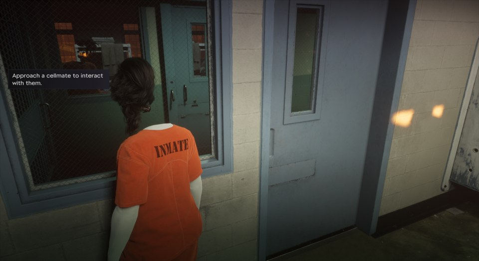
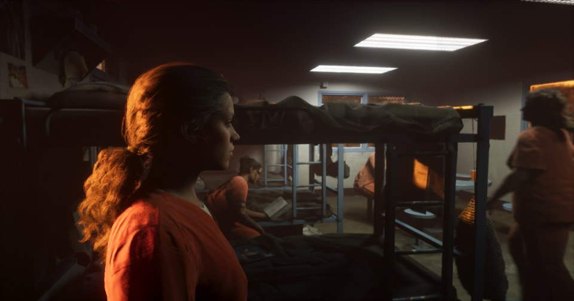
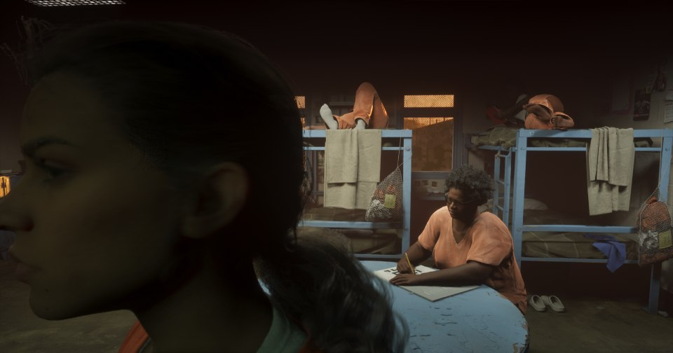
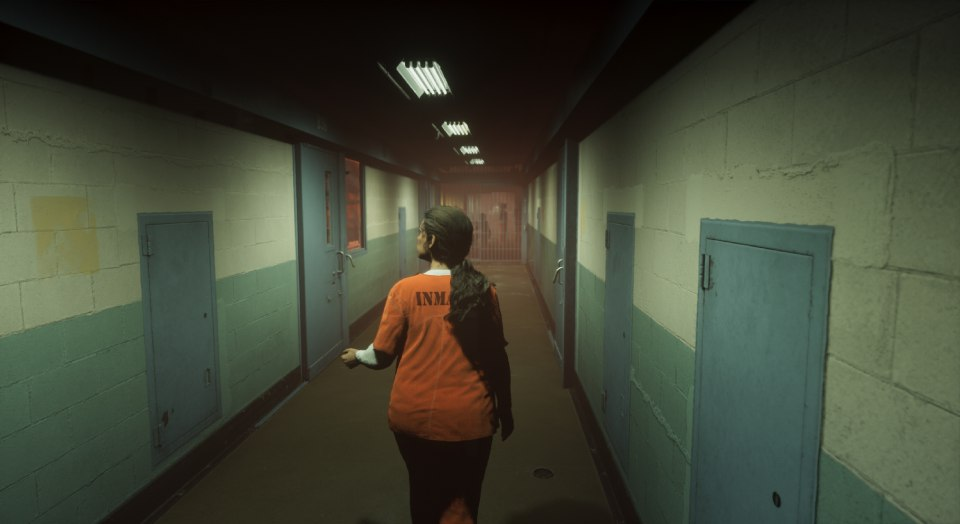
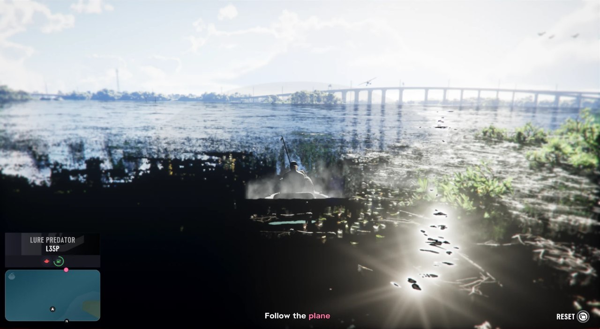
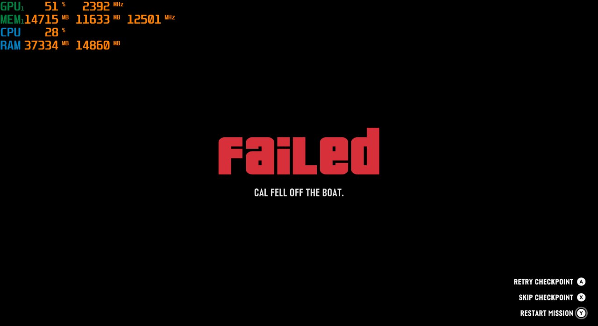
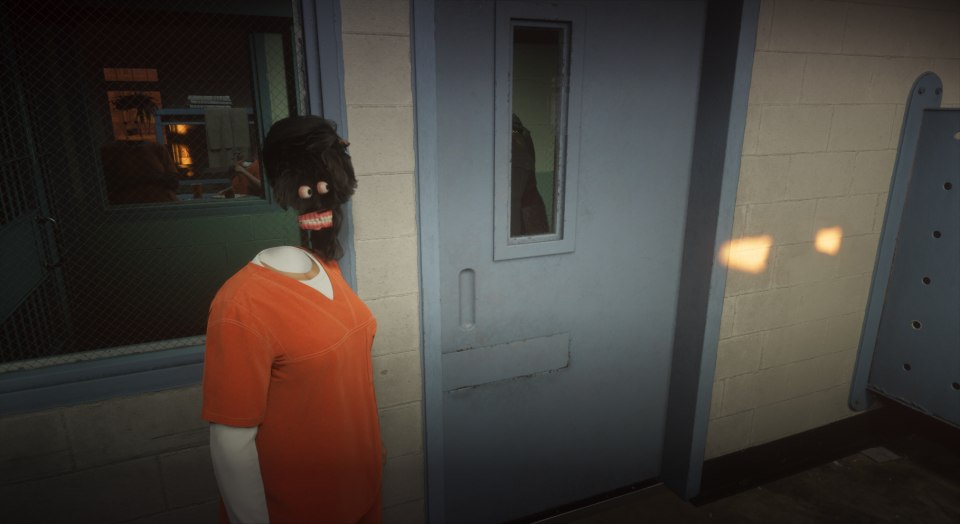

# victory-dedsec

Work on getting **Grand Theft Auto VI (the Xbox Series build)** to run on a Windows PC with an
NVIDIA card through [VIctory](https://github.com/Marvisak/VIctory), the compatibility layer written
in Rust: its own loader for the title's executable, the console's runtime services, Direct3D 12.X
on top of the PC's Direct3D 12, and a translator from the console's shader code (RDNA2 / GFX10)
straight to DXIL.

Since 2026-11-25 this repository builds on
[Trexies/victory-fork](https://github.com/Trexies/victory-fork), branch `VIwork` (commit `47ff7b0`),
which itself gathers [fxceless/victory-fork](https://github.com/fxceless/victory-fork),
[myokex/victory-amd](https://github.com/myokex/victory-amd) and many pull requests of both. Their
history is in this repository, and their README is kept in
[`docs/README-viwork.md`](docs/README-viwork.md). Licensed GPL-3.0-or-later, as they are.

**This repository contains no game files, code or assets, and says nothing about where to get any.**
You need your own copy of the game. It does nothing about encryption, DRM or licensing. It is not
affiliated with or endorsed by the game's developer or publisher.

## State (2026-11-25)

**Not playable: 4 to 6 frames per second.** Everything below was measured on one machine: Windows
Server 2025, 32-core Xeon, 123 GB RAM, NVIDIA RTX PRO 4500 (Blackwell, 32 GB; waves of 32 lanes
only). Series X profile. Nothing here was run on an AMD or Intel card.

| | State on that machine |
|---|---|
| Boot, menus | work, 30 fps (as upstream) |
| Opening cutscene | plays, lit, with its fades |
| Prologue (the prison) | played from start to finish in one session: cell block, corridors, characters with faces and clothes, HUD and prompts. Some textures are wrong |
| Open world | reached: the first mission on the water (a boat, "Follow the plane") runs with HUD, minimap and objective; the mission-failed screen and its checkpoint choices work |
| Saves | the title wrote its autosave at the end of the prologue; loading it back from the menu has not been checked here yet |
| Frame rate with the world drawn | median 228 ms a frame (4.4 fps) over the session; a tenth of the reports at 182 ms (5.5 fps) or better; best 168 ms (6 fps) |
| Stability | one session of **140 minutes without a crash, an exception or a device loss** (we ended it). One earlier session on the base without our DirectStorage change ended after 14 minutes at the title's own fatal breakpoint |
| Memory | about 27 GB of private memory once in the world, 34.6 GB at its peak |
| Light in shadow | missing: the title's ray-traced light does not run, so what the sun does not reach is dark |

How the session went: world's first frame 129 s after launch (shader cache warmed beforehand),
about 36,000 frames presented, no "request ran before its page array was filled" and no failed
DirectStorage request.

### Screenshots

All from this machine, 2026-11-25. The window caption's numbers are the layer's own.

| | |
|---|---|
|  Prologue, cell block |  The player, with this repository's DirectStorage change |
|  A shot of the opening cutscene |  Gameplay, camera turned to the player |
|  Corridor of the prison, 6 fps |  Open world, first mission on the water: note the black water (below) |
|  The mission-failed screen, 139 minutes into the session (the overlay in the corner is a monitoring tool's) |  The base without the DirectStorage change, one launch of three: the face is not drawn |

## What this repository adds to `VIwork`

Three commits so far, each with what was measured when it went in.

- **DirectStorage: a queue hands its requests over at the title's own submit, not by itself when
  half full** (`77f25f8`). The title names a request's destination pages after enqueueing it. A
  request the queue had handed over early could run with the page numbers of the array's last use:
  its bytes went into another model's pages, and the model meant for them never showed for the
  rest of the run. On the base, three launches logged 8 to 10 "a request ran before its page array
  was filled" each, and in one of them the player's face was missing for the whole run. With the
  change: none of those lines in 140 minutes, and the face is there. One launch does not settle a
  fault that showed in one of three.
- **Shaders: a count of lanes summed as doubles over the wave** (`8410ab7`). Three of the five
  `water_shading:CS_TransmissionVolumetrics` programs take `WaveActiveSum` of the literal 1.0,
  which the console compiler keeps in double precision. They translate now and pass the DXIL
  validator.
- **Shaders: the record count of a buffer the program only asks about** (`2210e63`).
  `ShallowWaterSim:CS_MinTimestepReduce`, dropped eight times a frame on open water, translates
  and validates.

For the two shader changes, every other translation of the pack is byte for byte what it was
(25,719 cache entries compared). **Their effect in the game has not been measured yet**: they are
what the black water of the screenshot above is being tested against.

`victory warm` now translates 25,723 of the 25,746 shader containers it takes from the title's
pack and its ray-tracing builder library (25,719 on the base); 23 are refused.

## Known problems

- **Speed.** Of some 170 to 230 ms a frame in the open world, about 140 are the CPU preparing
  copies of title memory; the card takes 14 to 24 ms and is idle about half of the time.
- **Water.** Large patches of open water come out black, with blocky edges. Two more water
  programs (`CS_TransmissionVolumetricsSubmerged`, `CS_WaterTransmittanceOpticalDepthProcessing`)
  still do not translate.
- **Light.** No ray-traced light: shade is dark.
- **Textures.** Some surfaces of the prologue show wrong textures.
- **Refused by the driver.** Five compute pipelines of wave64 programs were refused by this card's
  driver in that session.
- **Faces.** See above: missing in one launch of three on the base, not seen since the
  DirectStorage change, in too few launches to call it fixed.
- **One machine.** One PC, one card, one driver.

## The line before 2026-11-25

Branch [`linha-anterior`](../../tree/linha-anterior) is this project as it was until then, on
`fxceless/victory-fork` `2119b0e`; its README is kept in
[`docs/README-linha-anterior.md`](docs/README-linha-anterior.md). `VIwork` ran the game further and
faster on this card (5 to 6 fps against 3, a lit room, about 70 more shaders translated), so the work
moved onto it. Still to be carried over from that line, one at a time and measured: the halves of a
console wave followed together (three programs of the ray-tracing structure builder), the tools
(`precompile`, `pso-repro`, the `bench` feature), DirectStorage's page writes told to the copies of
title memory, and `VICTORY_WAVE_WIDE=last`.

## Building and running

Requirements: Windows 10/11 x64, a CPU with AVX2, a Direct3D 12 GPU with shader model 6.6 and mesh
shaders, Rust (pinned in `rust-toolchain.toml`). About 35 GB of memory free for the title.

```powershell
cargo build --profile diag -p victory --features diagnostics

# every shader into the cache first (about 25 minutes with the compute pipelines)
target\diag\victory.exe warm <game dir>\shaders.rpf <game dir>\XboxBvhBuilder.dll

target\diag\victory.exe run <game dir>\<the title's exe> --execute --console series-x
```

`VICTORY_CACHE_DIR` and `VICTORY_DATA_DIR` choose where the caches and the profile (saves,
settings, `crashes.log`) go. The window caption shows the frame rate. Input: XInput pads; with none
connected the keyboard is a pad while the window has focus, and a click captures the mouse for the
camera. The other commands, the switches and the design are described in
[`docs/README-viwork.md`](docs/README-viwork.md) and [`docs/architecture.md`](docs/architecture.md).

## Tests at this commit

Run here: `cargo test -p victory-shader` 218 passed (2 ignored) after the first shader change;
`cargo test -p victory-hle dstorage` 15 passed; `victory translate --validate` on the pack: 2,674
of 2,674 compute programs emitted pass the validator. The whole workspace's tests were not run on
this commit.

## Credits and licence

- **[VIctory](https://github.com/Marvisak/VIctory)** by Marvisak and its contributors is the base of
  everything here.
- **[fxceless/victory-fork](https://github.com/fxceless/victory-fork)**, and
  **[Trexies/victory-fork](https://github.com/Trexies/victory-fork)** `VIwork`, which this
  repository now builds on, with the work it gathers: Trexies, myokex
  ([victory-amd](https://github.com/myokex/victory-amd)), Vyacheslav Venglovsky, Joshua Odom, amehm,
  undeadhuman37, Noname0202, marquezini, spacede, AscilCH, Davi713, DoubleD17, FJBP-code,
  Jonirulah, Pablo Barros, TG0000, fffluffy-dev, gdawid94, gomeaw, iurysf, m335671, pgm1207 and the
  others named in the commit history.
- **[XCL](https://github.com/ivall/xcl)** by ivall and its contributors (GPL-2.0-only) was a
  reference of those projects for how the same title behaves under another layer; their READMEs say
  that what it inspired was written anew.
- Developed with [Claude Code](https://claude.com/claude-code).

GPL-3.0-or-later; see [`LICENSE`](LICENSE). The commit history of the projects above is part of
this repository.
